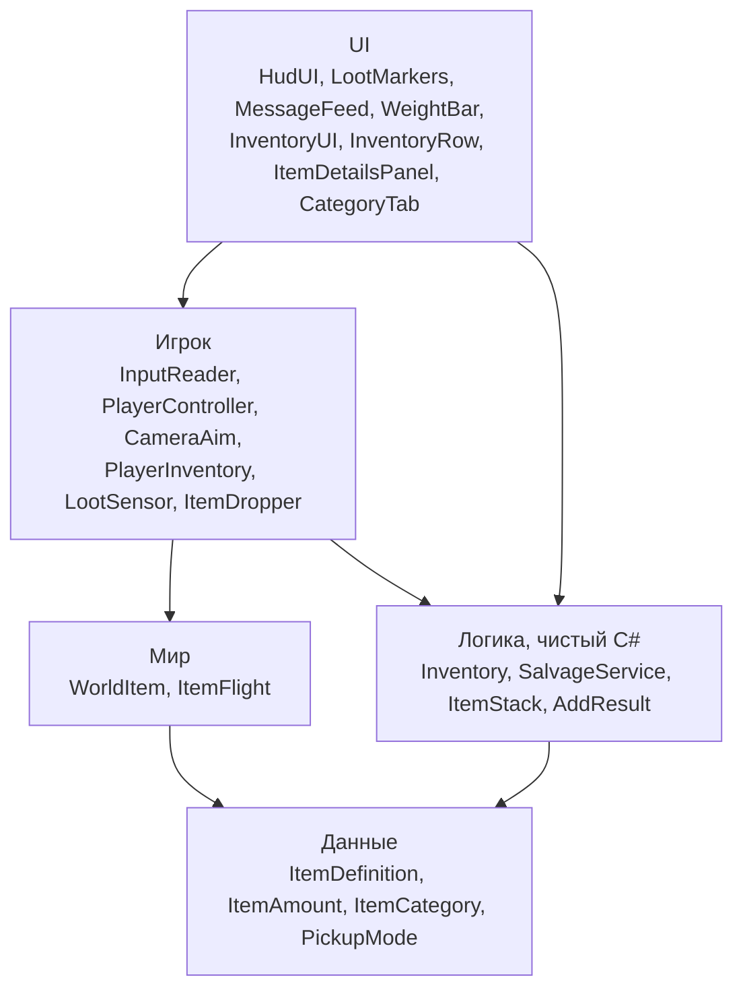
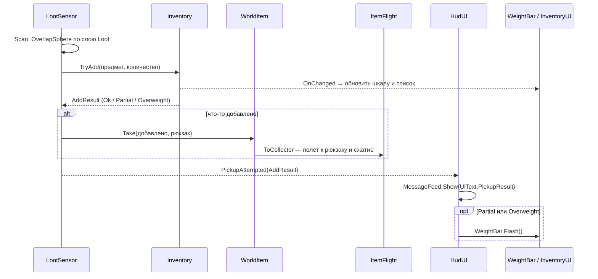

# Скрипты проекта: что делают и как связаны

Все скрипты лежат в `Assets/_Project/Scripts` и собраны в одну сборку (asmdef) `DeadAir`.

Код игры делится на слои, и зависимости идут только сверху вниз:

---

## 1. Данные — `Scripts/Items`

| Скрипт | Что делает |
| --- | --- |
| `ItemDefinition` | ScriptableObject — описание предмета: id, название, описание, иконка, категория, вес, размер стопки, способ подбора, список разборки, префаб для мира. |
| `ItemAmount` | Структура «предмет + количество». Из таких пар состоит список разборки. |
| `ItemCategory` | Перечисление: Consumable, RepairResource, Junk, Weapon. |
| `PickupMode` | Перечисление: Auto (подбирается сам) или Manual (по клавише E). |

Код не знает про конкретные предметы. Новый предмет — это новый ассет, код при этом не меняется.

## 2. Логика — `Scripts/Inventory` (чистый C#, без MonoBehaviour)

| Скрипт | Что делает |
| --- | --- |
| `Inventory` | Инвентарь с лимитом веса. Хранит стопки, считает вес. |
| `ItemStack` | Неизменяемая запись «предмет + количество» в инвентаре. Количество не больше `maxStack`. |
| `AddResult` | Итог `TryAdd`: сколько добавлено, сколько не влезло, свободный вес. Статус `Ok`, `Partial` или `Overweight`. |
| `SalvageService` | Разборка хлама: одна единица за раз, всё или ничего. Проверяет, что предмет — хлам и что он есть в инвентаре, затем вызывает `Inventory.TryExchange`. Возвращает `SalvageResult`. |

Методы `Inventory`:

- **`TryAdd`** — кладёт столько, сколько влезает по весу, и возвращает `AddResult` с причиной отказа.
- **`Remove`** — убирает предмет. Используется при выбросе.
- **`TryExchange`** — атомарный обмен для разборки: «убрать хлам, добавить компоненты». Либо выполняется целиком, либо ничего не меняет.
- **`OnChanged`** — событие, вызывается после каждого изменения.

Вес пересчитывается из стопок, а сравнения идут с допуском, чтобы ошибка float не мешала.

## 3. Мир — `Scripts/World`

| Скрипт | Что делает |
| --- | --- |
| `WorldItem` | Предмет на земле: ссылка на `ItemDefinition` и количество. Коллайдер — триггер на слое `Loot`. |
| `ItemFlight` | Короткая анимация полёта. **Подбор:** предмет притягивается к рюкзаку с разгоном и последнюю треть пути сжимается в ноль, затем уничтожается. **Выброс:** предмет вылетает из рюкзака на землю и вырастает из нуля. Пока предмет летит, его коллайдеры выключены. |

Что умеет `WorldItem`:

- **`MarkerPosition`** — точка над предметом, где рисуется скобка.
- **`Take`** — забирает часть кучки и отправляет её в `ItemFlight` к рюкзаку. Если забрано всё, летит сам объект, иначе — его копия.
- **`SpawnDropped`** — создаёт выброшенный предмет. У такого предмета автоподбор на паузе, пока игрок не отойдёт.

## 4. Игрок — `Scripts/Player`

| Скрипт | Что делает |
| --- | --- |
| `InputReader` | Единственный класс, который читает ввод. Клавиатура — старый Input Manager: оси Horizontal и Vertical, клавиши E, Tab, X, G (меняются в инспекторе). Движение мыши — Input System (`Mouse.current.delta` × 0.1, как у старых осей Mouse X / Mouse Y): на macOS старые оси при захваченном курсоре дают 0. Режим Active Input Handling — Both. Пока идёт игра, курсор скрыт и захвачен (`Locked`); если его отпустит редактор, `InputReader` возвращает его, кроме случая, когда игрок сам нажал Escape. Отдаёт `Move` и `Look`, события `InteractPressed`, `ToggleInventoryPressed`, `SalvagePressed`, `DropPressed`. `SetGameplayEnabled(false)` отключает движение, камеру и подбор и освобождает курсор, когда открыт инвентарь. |
| `PlayerController` | Движение через CharacterController относительно камеры. Вес на скорость не влияет. |
| `CameraAim` | Висит на `CameraTarget` у плеч героя: мышь поворачивает эту точку, клавиша X переносит камеру на другое плечо (при открытом инвентаре та же X разбирает хлам). Саму камеру ведёт Cinemachine: `CinemachineCamera` с `CinemachineThirdPersonFollow` на объекте `PlayerFollowCamera` — камера за плечом с плавным следованием и отъездом от стен, `CinemachineBrain` на Main Camera. |
| `PlayerInventory` | Точка входа на сцене: лимит веса задаётся в инспекторе, при первом обращении создаёт `Inventory` и `SalvageService`. |
| `LootSensor` | Сенсор лута вокруг игрока, работает 10 раз в секунду. Подробности — под таблицей. |
| `ItemDropper` | Выброс: убирает 1 шт. через `Inventory.Remove`, находит точку на земле перед игроком (Raycast) и создаёт `WorldItem.SpawnDropped` с полётом из рюкзака. |

Что делает `LootSensor`:

- ищет предметы в радиусе 6 м через `OverlapSphere` по слою `Loot`;
- предметы с автоподбором в радиусе 1.5 м подбирает сам;
- выбирает предмет в фокусе: ручной подбор, не дальше 2.5 м, ближе всех к центру экрана и к игроку;
- по E подбирает предмет в фокусе;
- отдаёт HUD список видимого лута. Предметы за препятствием туда не попадают (Linecast от камеры);
- о перегрузе при автоподборе сообщает один раз, пока игрок не отойдёт от предмета;
- снимает паузу автоподбора с выброшенного предмета, когда игрок отходит от него дальше 2.5 м;
- о каждой попытке подбора сообщает событием `PickupAttempted(AddResult)`.

## 5. Интерфейс — `Scripts/UI`

| Скрипт | Что делает |
| --- | --- |
| `UiPalette` | Цвета из гайда проекта. Красного нет: он закреплён за угрозой. |
| `UiText` | Собирает все строки интерфейса из данных: «+5 Болты», «Перегруз: …», «Разобрано: …», «−1 …», названия категорий. Логика возвращает только статусы и числа. |
| `HudUI` | Подписан на `LootSensor.PickupAttempted`: итог подбора выводит в ленту, при отказе по весу запускает вспышку шкалы веса. |
| `LootMarkers` | Янтарные скобки над лутом на Canvas. 16 готовых скобок лежат на сцене (`HUD/Markers`), скрипт только включает их и двигает. Подробности — под таблицей. |
| `MessageFeed` | Лента сообщений в углу: 4 готовые строки на сцене (`Messages`), гаснут через ~3.5 с. Если все заняты, новое сообщение пишется в самую старую строку. |
| `WeightBar` | Шкала «12.6 / 15.0». Обновляется по `Inventory.OnChanged`, метод `Flash()` даёт янтарную вспышку. На сцене две такие шкалы: в HUD и в инвентаре. |
| `InventoryUI` | Экран инвентаря. Подробности — под таблицей. |
| `InventoryRow` | Строка списка: иконка, название, количество, вес. |
| `CategoryTab` | Вкладка-фильтр: «Все» или одна категория. |
| `ItemDetailsPanel` | Детали выбранного предмета: описание, вес, способ подбора, компоненты разборки, кнопки «Разобрать» (только у хлама) и «Выбросить». Только показывает, действий не выполняет. |

Что делает `LootMarkers`:

- у каждой скобки своё состояние: она плавно появляется, «сходится» на предмет из увеличенного размера и гаснет на месте, когда предмет пропал;
- скобка предмета в фокусе крупнее и ярче;
- над ней появляется подпись «[E] Подобрать: …».

Что делает `InventoryUI`:

- открывается и закрывается по Tab;
- показывает список стопок, вкладки и детали: 16 готовых строк лежат на сцене в `Content`, лишние выключены;
- по X и кнопке разбирает предмет через `SalvageService`;
- по G и кнопке выбрасывает предмет через `ItemDropper`;
- после изменений перерисовывается по `Inventory.OnChanged`;
- если выбранный предмет пропал, выделяет строку, которая встала на его место.

UI не меняет данные напрямую — только через методы `Inventory`, `SalvageService` и `ItemDropper`.

UI-скрипты ничего не создают в игре: все элементы интерфейса заранее собраны на сцене, а скрипты получают их через массивы в инспекторе (`LootMarkers.markerImages`, `MessageFeed.lines`, `InventoryUI.rows`) и только включают, выключают и заполняют. Сколько элементов в массиве — столько скобок, сообщений или строк списка видно одновременно. Чтобы увеличить лимит, продублируйте элемент на сцене и добавьте его в массив.

---

## 6. Как всё работает вместе

### Автоподбор и подбор по E

### Разборка

`InventoryUI.SalvageSelected` → `SalvageService.Salvage` → `Inventory.TryExchange`. Если всё прошло:

1. `OnChanged` перерисовывает список и шкалу веса.
2. `InventoryUI` выводит в ленту «Разобрано: …».

### Выброс

`InventoryUI.DropSelected` → `ItemDropper.Drop`. Дальше:

1. `Inventory.Remove` убирает 1 шт., `OnChanged` обновляет экран.
2. `WorldItem.SpawnDropped` создаёт предмет на земле, автоподбор у него на паузе.
3. `ItemFlight.Drop` проигрывает полёт из рюкзака на землю.
4. В ленте появляется «−1 …».

### Ввод

`InputReader` — единственный источник ввода:

| Кто | Что берёт |
| --- | --- |
| `PlayerController` | `Move` |
| `CameraAim` | `Look`, X |
| `LootSensor` | E |
| `InventoryUI` | Tab, X, G |

Когда инвентарь открыт, `InventoryUI` вызывает `SetGameplayEnabled(false)`: `Move` и `Look` возвращают ноль, E игнорируется.

### Ссылки между компонентами

Все ссылки проставлены в инспекторе: синглтонов и `FindObjectOfType` нет.

`PlayerInventory` создаёт `Inventory` лениво, при первом обращении. Поэтому порядок `Awake`/`OnEnable` у подписчиков не важен.
